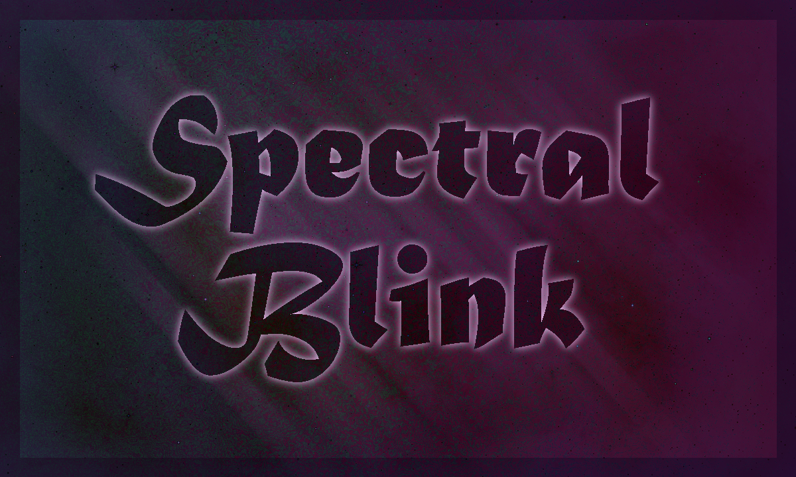

# Spectral Blink

<p align="center">Developed by Ahmad Al Muzanen, Nico Ranin, Robert Rodriguez, Brandon Nevestuk, and Carl Asojo</p>

## What our project does
Spectral Blink allows anyone to watch the infrared sky change with NASA's SPHEREx. This project was designed for NASA Space Apps Challenge 2026: Planet X and SPHEREx.

In this project, you can enter either any sky position (ex. `269.45, 4.69`, `08h55m10.8s -7d14m42s`) or a name (ex. `WISE 0855`). Spectral Blink then pulls every SPHEREx exposure of that patch from NASA/IRSA, aligns them, and plays the sky surveys as a smooth 'blink' animation. With this animation, moving things will visibly jump and changing things will visibly pulse. Given the fact that SPHEREx sees 102 infrared colours, it measures a spectrum for anything you click (allowing one to measure the brightness of that spot), as well as displaying where specific molecules are (which aids in the identification of specific celestial bodies).

| Features | Why it exists |
|---|---|
| Blink each six-month all-sky survey (per detector, or all bands combined) | This spots nearby stars, brown dwarfs and variable stars |
| Difference mode (each survey minus the others) | Steady stars will cancel out whilst moving objects become highly visible blue/amber pairs |
| Molecule lens (CH₄, H₂O, CO₂, CO) | Compares light in vs. out of a molecular band: thus, ordinary stars vanish whilst methane brown dwarfs glow |
| Shift-and-stack along any motion | Reveals objects too faint to see in just one survey (ex. WISE 0855) |
| Click → spectrum (0.75–5 µm) with a molecular fingerprint and blackbody fit | This provides labels (ex. Epsilon Indi B, a brown dwarf, is automatically labelled "strong methane: T/Y brown dwarf" |
| Brightness tab compares surveys at matched wavelengths (with PSF-halo method for saturated stars) | This shows RW Aur (+46 %) and R Dra (Mira, ~73 %), both flagged variable, whilst Barnard's Star is flagged as steady |
| Gaia DR3 overlays with positions moved to each survey date, showing fast moving objects drawn with their track | This validates motion
| Proper-motion-aware search | This shows how positions have moved (ex. Barnard's Star has moved 4.5′ since J2000) |

## Set-Up Instructions
Spectral Blink runs locally. It requires an internet connection given NASA APIs are used.

### 1. Get the code
To begin, either download the code (click the green `Code` button on the repository page, click `Download ZIP`, then unzip the folder), or git clone it (run  `git clone https://github.com/kersplash-wav/Spectral-Blink.git` and then `cd Spectral-Blink` in your terminal).

### 2. Run the code
For this, you can either use Docker (this is easier, given that you have Docker installed) or your terminal (this would require having Python 3.12 and Node.js 22 installed).

### Docker
If using Docker, run the following lines:
```bash
docker build -t spectral-blink .
docker run -p 8000:8000 spectral-blink
```

The first build will take a few minutes, given the project size. Upon the build finishing, open http://localhost:8000.

### Manual
If not using Docker, run the following lines:
```bash
# These lines are for the back-end
python3 -m venv .venv && .venv/bin/pip install -r backend/requirements.txt
.venv/bin/uvicorn backend.app.main:app --port 8000
# This line is for the frontend
cd frontend && npm install && npm run dev
```
The first build will take a few minutes, given the project size. Upon the build finishing, open http://localhost:5173.

### Optional
If you'd like to use the cache for the demo targets to load more quickly, type the following in your terminal: `python -I scripts/precompute.py`.

## Validation on NASA Space Apps targets
- **Barnard's Star**: measured shift of about 10″ north over ~1 year in D6 (Gaia: 10.4″/yr).
- **Epsilon Indi B**: CH₄ absorption 82 % deep and a 4 µm peak, the classic T-dwarf spectrum; 2000σ in the methane lens.
- **WISE 0855**: at SPHEREx's single-survey limit (~6σ in D6). Stacking surveys helps.
- **RW Aurigae**: +46 % between surveys. **R Draconis**: ~73 % swing (Mira pulsation), via PSF-halo photometry.

## New SPHEREx data
Releases are queried live from IRSA. When a new release appears, add its collection name:
`SPHEREX_COLLECTIONS=spherex_dr1,spherex_qr3,spherex_qr4` (env var, or `backend/app/config.py`). Nothing else changes.

## How our project works
```
Browser (React)                                 FastAPI backend
  stretch, colour, diff, stack (all client-side)   IRSA SIA query → exposure list
  NDJSON stream reader → frames sharpen live       stream cutouts, stop before 4 MB PSF table (~100 KB each)
  canvas viewer, Gaia overlay, spectrum charts     reproject → common grid, flag-mask, inverse-variance co-add
                                                   λ per pixel from the WCS-WAVE table (+ gradient)
                                                   aperture / PSF-halo photometry, molecule indices
```
API: `/api/resolve`, `/api/frames` (NDJSON stream), `/api/spectrum`, `/api/molecule`, `/api/overlays`.

See [REFERENCES.md](REFERENCES.md) for data and library credits.

## Video
For this project, we created a 30-second demo video which summarizes the information above. You can click the image below to access the YouTube video.

<p align="center">
  <a href="https://www.youtube.com/watch?v=SDyuH84p-a0">
    
  </a>
</p>
